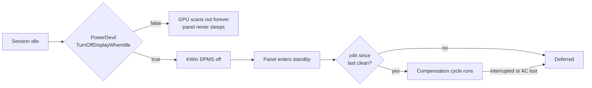

# 🖥️ OLED Pixel Refresh on KDE Wayland

[](https://kde.org/plasma-desktop/) [](https://wayland.freedesktop.org/) [](https://invent.kde.org/plasma/powerdevil) [](https://github.com/NVIDIA/open-gpu-kernel-modules)

Getting QD-OLED panels to actually run their pixel-cleaning / compensation
cycles under KDE Wayland. Short version: the panels were never at fault, the
compositor was never blanking them.

---

## 🧩 Panels

Three OLEDs on this workstation. Model strings below are from EDID
(`strings /sys/class/drm/card1-DP-*/edid`), not from the box.

| Output | Model | Panel | Mode |
|--------|-------|-------|------|
| `DP-2` | ASUS ROG Swift **PG32UCDM** | 32" QD-OLED (gen3) | 3840x2160 @ 240 Hz, HDR |
| `DP-3` | Alienware **AW2725DF** | 27" QD-OLED | 2560x1440 @ 360 Hz, HDR |
| *(incoming)* | ASUS **PG32UCDM3** — gen4 QD-OLED | 32" QD-OLED (gen4) | 3840x2160 @ 240 Hz, DP 2.1 |

> The incoming panel's exact model string is unconfirmed — capture it from EDID
> once it's attached and correct this table.

GPU is the RTX 5090 on the NVIDIA open DKMS module; all three run off
`card1` (`0000:01:00.0`).

---

## ⚙️ How the cycle actually triggers

The compensation cycle runs when the monitor **enters standby** — when the GPU
stops scanning out to it. It cannot be triggered from the OS directly, and it
will never run while a signal is present.

On ASUS QD-OLED there is **no "Auto Pixel Cleaning" toggle**. Auto cleaning is
unconditional. OLED Care only exposes Screen Dimming (Global / Outer), Adjust
Logo Brightness, Screen Move, Pixel Cleaning (manual), and Pixel Cleaning
Reminder. There is nothing to enable — if cleaning isn't happening, the host is
the problem.

Two gates on the automatic cycle:

1. ~4 hours of cumulative panel-on time since the last run.
2. Several uninterrupted minutes in standby, **with AC power present**.

This is why the monitor's own power button is unreliable: it rarely satisfies
both, and switching back on a few minutes later aborts the cycle.



---

## 🐛 Root cause (2026-09-16)

`~/.config/powerdevilrc` had screen-off-when-idle disabled outright:

```ini
TurnOffDisplayWhenIdle=false
TurnOffDisplayIdleTimeoutSec=-1
```

So the GPU scanned out continuously for as long as the session was unlocked.
Neither panel ever saw a standby transition. The only path that blanked them was
locking the session and waiting out
`TurnOffDisplayIdleTimeoutWhenLockedSec=900`.

---

## 🔧 Configuration

```ini
[AC][Display]
TurnOffDisplayWhenIdle=true
TurnOffDisplayIdleTimeoutSec=600
TurnOffDisplayIdleTimeoutWhenLockedSec=900
```

Set via System Settings → Power Management, or:

```sh
kwriteconfig6 --file powerdevilrc --group AC --group Display \
  --key TurnOffDisplayWhenIdle true
kwriteconfig6 --file powerdevilrc --group AC --group Display \
  --key TurnOffDisplayIdleTimeoutSec 600
qdbus6 org.kde.Solid.PowerManagement /org/kde/Solid/PowerManagement \
  reparseConfiguration
```

`reparseConfiguration` applies it live. No session or service restart required.

---

## 🎛️ Blanking on demand

```sh
kscreen-doctor --dpms off
```

That is the correct call on Wayland. `xset dpms force off` does nothing here —
it only reaches XWayland.

Bound to a shortcut, add a delay so the key release doesn't immediately wake the
displays:

```sh
sh -c 'sleep 1; kscreen-doctor --dpms off'
```

Lock and blank together:

```sh
loginctl lock-session; sleep 2; kscreen-doctor --dpms off
```

`--dpms-excluded <connector>` leaves a named output alone — useful with three
panels when only some should sleep.

> **Do not** use `kscreen-doctor output.DP-2.disable` for this. That is a
> hotplug/unplug event and reshuffles windows onto the remaining screens. DPMS
> off keeps the output object intact.

---

## ✅ Verifying

1. Run `kscreen-doctor --dpms off`, hands off mouse and keyboard. Power LEDs
   should go amber/off within a second or two.
2. Leave the desk 10+ minutes and confirm the panels blank unprompted.

A display that wakes instantly means something is generating input events —
sensor drift on a high-polling mouse is the usual cause, and it defeats the idle
timer too.

If nothing blanks while idle, check inhibitors:

```sh
systemd-inhibit --list
```

Discord in a call, browser video, and Steam Big Picture take real idle inhibits.
`delay`-mode inhibitors on `sleep` (NetworkManager, rtkit, UPower, libvirt) are
unrelated and harmless.

---

## ⚠️ Gotchas

- **Manual** Pixel Cleaning from the OSD resets the cumulative-hours counter.
  After a manual run the next automatic cycle is ~4 hours of panel-on time away.
  Silence immediately after a manual clean is expected, not a failure.
- Never cut AC to a panel that may be mid-cycle. No switched strips, no smart
  plugs on a timer.
- Leave Pixel Cleaning Reminder enabled so the monitor prompts at its threshold.
- PowerDevil drives the panels over DDC/CI (`/dev/i2c-5`, `/dev/i2c-6`) via
  libddcutil and logs noisy unsupported-feature probes. Harmless, but DDC
  transactions against a monitor in standby can be flaky — remember this if
  wake-from-DPMS ever misbehaves.

---

## 🔌 Gen4 panel / DP 2.1

When the third panel lands, confirm it enters standby cleanly on
`kscreen-doctor --dpms off` while running its native DP 2.1 UHBR20 mode.
Link-training trouble at UHBR20 on NVIDIA is the most likely failure point. If
it won't blank, drop to DP 1.4 + DSC in the OSD and retest before suspecting
KWin.

Also re-check `TurnOffDisplayIdleTimeoutWhenLockedSec` and per-output DPMS
behaviour once three outputs are live — the idle logic is session-wide, but the
panels will have independent cumulative-hour counters.
